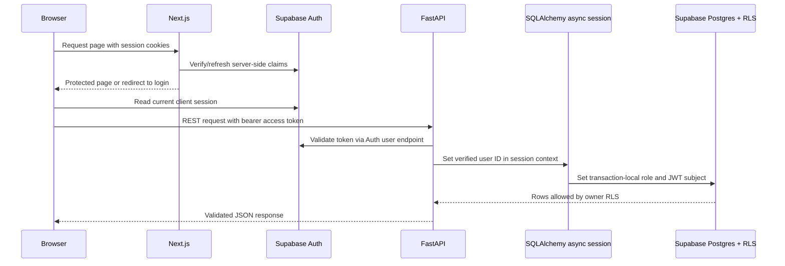

# Architecture and code map

Finora is a monorepo with a Next.js frontend and a FastAPI modular monolith. The browser never connects directly to the application tables; requests for private records go through FastAPI.

## Request path

In the current implementation, FastAPI calls Supabase Auth's user endpoint for each bearer-token request. This is straightforward for the prototype but adds network latency. Do not replace it with unverified client identity. Any future JWT/JWKS optimization must preserve signature, expiry, issuer, audience, owner, and RLS checks.

## Service ownership

| Responsibility | Owner | Main paths |
| --- | --- | --- |
| Public landing, login, recovery, protected route | Next.js App Router | `frontend/src/app/`, `frontend/src/proxy.ts` |
| Session-aware Supabase clients | Next.js | `frontend/src/lib/supabase/`, `frontend/src/app/auth/` |
| Workspace shell and sections | React client components | `frontend/src/components/prototype/` |
| API calls, token attachment, in-memory response cache | Frontend API layer | `frontend/src/lib/api.ts` |
| Query hooks and mutations | TanStack Query hooks | `frontend/src/hooks/useFinancialData.ts` |
| REST routing and HTTP validation | FastAPI | `backend/app/api/v1/`, `backend/app/schemas/` |
| User identity and DB dependency | FastAPI | `backend/app/api/deps.py`, `backend/app/core/database.py` |
| Domain parsing, normalizing, analysis | Python domain modules | `backend/app/domain/` |
| ORM entities | SQLAlchemy | `backend/app/db/models/` |
| Hosted schema, roles, RLS | SQL migration | `supabase/migrations/` |
| Local/demo database setup | SQLAlchemy metadata and seed path | `backend/app/main.py`, `backend/app/db/seeder.py` |

## Frontend runtime

- Next.js App Router serves `/`, `/login`, `/reset-password`, `/dashboard`, and `/dashboard/demo`.
- `frontend/next.config.mjs` rewrites `/api/v1/*` to `127.0.0.1:8000` in local development.
- `frontend/src/lib/api.ts` obtains the current Supabase session, attaches its access token, and uses a tab-memory cache for successful authenticated GET responses. Cache entries are user-scoped, bounded, deduplicated, selectively invalidated, and cleared on sign-out. `BroadcastChannel` propagates invalidations where available.
- TanStack Query also manages data states for several feature screens. This means there are two client cache mechanisms; avoid adding a third or assuming they share invalidation semantics.
- Theme choice is kept as a display preference in browser local storage. Financial API data is not intentionally written there.
- Local images in `public/images` use direct static URLs. `images.unoptimized` in the Next config works around the hosted `/_next/image` route returning the app's 404 response in the multi-service deployment.

## Backend and persistence

- FastAPI exposes `/api/v1/*`; route modules map to auth, accounts, transactions, summaries, statements, simulated bank sync, calendar, budgets, goals, and analytics.
- Pydantic v2 validates inputs and response shapes.
- SQLAlchemy 2 async sessions are injected through `get_db`. Hosted Postgres uses `asyncpg`. Isolated tests use SQLite/`aiosqlite`.
- `supabase/migrations/20261121220000_initial_finora_schema.sql` is the hosted schema source. It creates the profile mirror, reference data, accounts, transactions, budgets, goals/milestones, and ML profile table; it also creates the restricted app role and owner-scoped RLS policies.
- Local mode uses its own setup/seed path; do not confuse local `create_all()` behavior with hosted migration state.

## Feature-to-code map

| Feature | Frontend | Backend |
| --- | --- | --- |
| Accounts | `components/prototype/AccountsScreen.tsx` | `api/v1/accounts.py` |
| Statement review/import | `components/prototype/PrototypeDashboard.tsx` and `components/import/` | `api/v1/statements.py`, `domain/statement_import/` |
| Transactions and monthly summary | `components/prototype/TransactionsScreen.tsx`, `WorkspaceOverview.tsx` | `api/v1/transactions.py` |
| Calendar | `components/prototype/CalendarScreen.tsx` | `api/v1/calendar.py`, `domain/services/calendar_service.py` |
| Budgets | `components/prototype/BudgetsScreen.tsx` | `api/v1/budgets.py` |
| Goals | `components/prototype/GoalsScreen.tsx` | `api/v1/goals.py`, `domain/services/goal_service.py` |
| Standard analytics | `components/prototype/InsightsScreen.tsx` | `api/v1/analytics.py`, `domain/ml/` |
| Synthetic FinGraph | `components/charts/StockMarketFinancialChart.tsx` | `frontend/src/lib/demo-data.ts` |
| Simulated bank adapter | `components/prototype/LiveBankConnectCard.tsx` | `api/v1/bank.py`, `domain/bank_adapters/` |

## Hosting topology

The root `vercel.json` defines frontend and backend services. `/api/v1/*` and `/health` route to FastAPI; other paths route to Next.js. Local image paths are served directly rather than through the Next image optimizer because the deployed optimizer route returned 404 while the underlying public assets returned 200 (observed 2026-11-24). See [operations](operations.md) for hosted boundaries.
