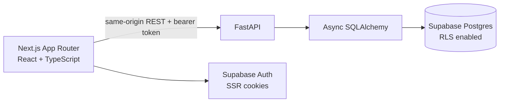

# Finora

Finora helps people make sense of the financial records they choose to add. It turns reviewed transactions into a calendar, spending summaries, budgets, goals, and statistical explanations.

**The workspace starts empty.** Public examples and the long-range chart are synthetic. The bank adapter is simulated; Finora does not connect to real banks or fetch market prices.

[Open the current demo](https://finora-sem3.vercel.app/) · [Read the Context Manager](Context-Manager/README.md) · [Report a security issue](SECURITY.md)

## What works today

- Public product page with an interactive financial walkthrough, calculator, and illustrative plan cards.
- Supabase Auth sign-up, sign-in, password recovery callback, and protected workspace routes.
- User-owned account labels and canonical transaction records through FastAPI.
- CSV statement preview, row editing, deduplication, and explicit import confirmation.
- Optional PDF/image extraction code using PaddleX; the default hosted deployment does not install that OCR runtime.
- Monthly overview, transaction ledger, calendar, budgets, goals, and rule/statistics-based insights.
- Demo and theme controls, including Fin, Dark, and AMOLED appearance modes.
- A 10-year “FinGraph” visual built from generated sample records. It is not real stock-market data, investment tracking, or a forecast of an individual user's wealth.

## What is not implemented

- Real bank connections or transfer/payment capabilities.
- Billing, subscriptions, server-enforced plan entitlements, or team access. Public plans are concepts.
- Trained machine-learning models, an LLM, or a retrieval-augmented generation system. Analytics are deterministic statistics and rules.
- Production-ready OCR accuracy. Scanned-document extraction needs the optional runtime and has not been benchmarked against bank layouts.
- Frontend unit or end-to-end test suites. Current CI runs backend tests and frontend lint, typecheck, and build checks.

Read [product truth and capability status](Context-Manager/product-truth.md) before describing the product or adding claims.

## Architecture



The frontend and API are separate services in one repository. In development, Next.js runs on port `3000` and rewrites `/api/v1/*` to FastAPI on port `8000`. In Vercel, the root [`vercel.json`](vercel.json) routes the same paths to separate services. More detail is in [Context-Manager/architecture.md](Context-Manager/architecture.md).

### Main stack

| Layer | Technology |
| --- | --- |
| Web | Next.js App Router, React, strict TypeScript, Tailwind CSS, custom CSS tokens |
| UI | TanStack Query, Recharts, Lucide; GSAP/ScrollTrigger, Lenis, and Anime.js on the public landing page |
| API | FastAPI, Pydantic v2, Python 3.13 |
| Persistence | SQLAlchemy async, Postgres/`asyncpg`; SQLite for isolated local tests/demo mode |
| Identity | Supabase Auth and `@supabase/ssr` |
| Hosting | Vercel Services for frontend and backend |

## Run locally

Use Python 3.13 and Node.js 20. Configure local Supabase values before expecting sign-up or authenticated API requests to work.

```bash
# Terminal 1: backend
cd backend
python3.13 -m venv .venv
source .venv/bin/activate
pip install -r requirements.txt
cp .env.example .env
DEBUG=false python -m pytest -q
uvicorn app.main:app --reload --host 127.0.0.1 --port 8000
```

```bash
# Terminal 2: frontend
cd frontend
npm ci
cp .env.local.example .env.local
npm run dev -- --hostname 127.0.0.1
```

Set the values in the two ignored environment files using [the Supabase setup guide](docs/supabase/setup.md). Never commit `.env`, `.env.local`, database passwords, bearer tokens, Supabase secret keys, or service-role keys. Open `http://127.0.0.1:3000`; the FastAPI health endpoint is `http://127.0.0.1:8000/health` and interactive API docs are at `http://127.0.0.1:8000/api/v1/docs`.

Without the API running, local frontend API calls can fail with `ECONNREFUSED 127.0.0.1:8000`. The unauthenticated demo route is `/dashboard/demo`; it is for UI exploration and is not evidence that hosted persistence or auth works.

## Checks

Run the relevant checks from the service directory before handing off a change:

```bash
# backend
cd backend
DEBUG=false python -m pytest -q

# frontend
cd frontend
npm run lint
npm run typecheck
npm run build
```

These checks do not prove hosted email delivery, Vercel routing, Supabase RLS configuration, OCR accuracy, or browser accessibility. Use the [verification guide](Context-Manager/development.md#verification) and record what was actually exercised.

## Documentation

- [Context Manager](Context-Manager/README.md) — authoritative project orientation, architecture, data/security contracts, setup, and known gaps.
- [Agent instructions](AGENTS.md) — repository-wide working rules.
- [Frontend instructions](frontend/AGENTS.md) and [backend instructions](backend/AGENTS.md) — scoped code conventions.
- [Visual system](DESIGN.md) — themes, typography, imagery, and motion.
- [Supabase setup](docs/supabase/setup.md) and [Vercel deployment](docs/deployment/vercel.md) — environment and hosted setup.
- [Product documents](docs/product/) — concepts and requirements; these may describe future intent. They do not override shipped code.
- [Shared agent skills](.agents/skills/) — reusable design, browser, and interface-review workflows.

## Contributing

The repository is a fork. `origin` is the FinSOL2 fork and `upstream` is the original Finora repository. Work on a feature branch, fetch both remotes before syncing, preserve unrelated changes, and do not rewrite `main` unless the maintainer explicitly asks. See [CONTRIBUTING.md](CONTRIBUTING.md) and [milestone history](docs/agents/history.md).
