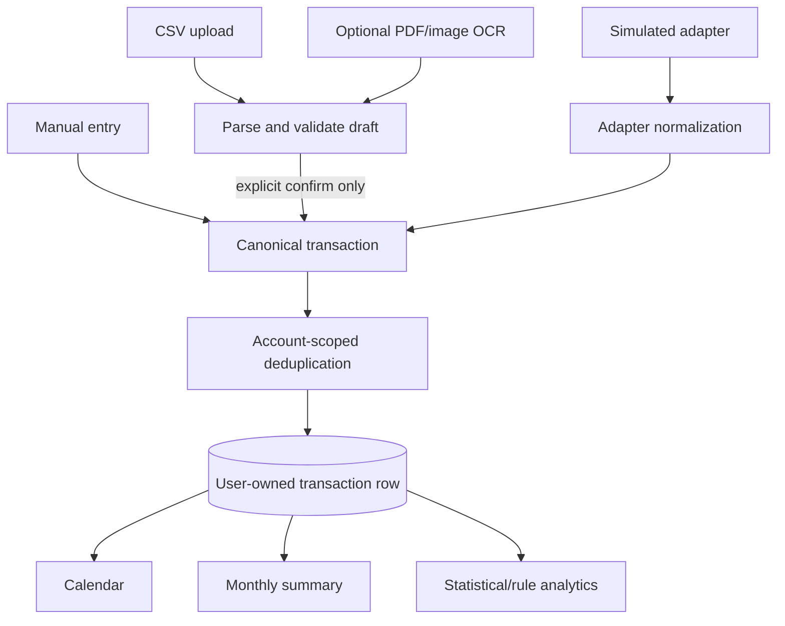

# Canonical transaction flow

The canonical transaction model is the shared representation for user-reviewed imports, manual entries, and simulated adapter records.

## Persisted shape

- `amount` is an absolute positive decimal; `transaction_type` carries `DEBIT`, `CREDIT`, or `TRANSFER` direction.
- `currency` remains attached to every row. No conversion is implied.
- `raw_description` preserves source text; reviewed merchant/category labels are separate metadata.
- `account_id` and `user_id` are server-validated and owner-scoped.
- The deduplication hash is computed from account and transaction identity fields; imports skip repeated hashes.

## Entry points

- CSV/optional OCR: `backend/app/domain/statement_import/` and `api/v1/statements.py`.
- Manual entry/delete/filter/summary: `backend/app/api/v1/transactions.py`.
- Simulated adapter: `backend/app/domain/bank_adapters/` and `api/v1/bank.py`.
- Schema: `backend/app/schemas/canonical_transaction.py` and `backend/app/db/models/transaction.py`.

Do not describe XLSX parsing, live bank sync, automatic categorization accuracy, or persisted categories as implemented unless the current code supports the claim.
